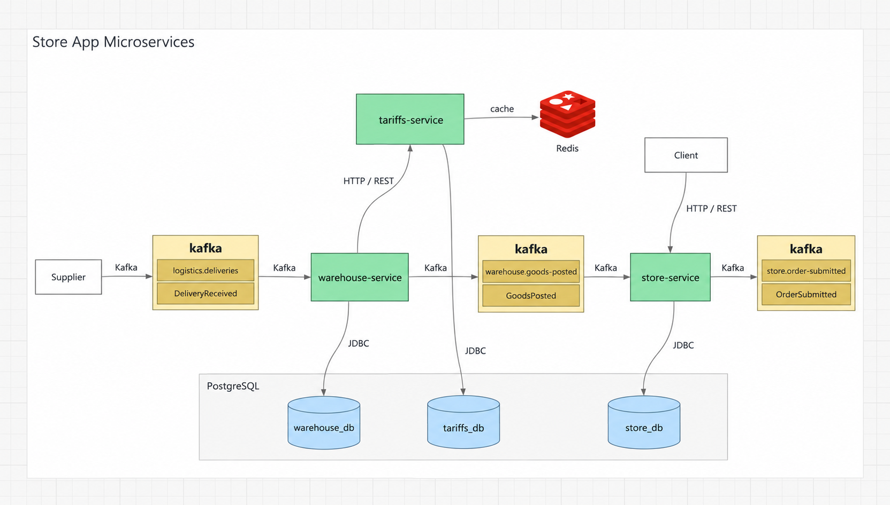

# Store App Microservices



## Что это за продукт

Учебный магазин на Java 21 и Spring Boot 3: приёмка поставок, расчёт продажных цен, каталог, корзины и оформление заявок. Проект появился после курсов QA.GURU и консультаций [Alexandr056](https://github.com/Alexandr056).

- **WAREHOUSE** принимает поставки через Kafka, получает наценку от TARIFFS и передаёт товары в STORE.
- **TARIFFS** управляет тарифными правилами и рассчитывает наценку; результаты кешируются в Redis.
- **STORE** хранит остатки, обслуживает независимые корзины и публикует оформленные заявки в Kafka.

У каждого сервиса своя база PostgreSQL. STORE использует Spring Data JPA, WAREHOUSE и TARIFFS — JDBC. Интерфейс — HTML и JavaScript; автотесты — Java и Kotlin с Rest Assured, Selenide и Allure.

## Основные возможности

1. Отправить поставку из формы поставщика и дождаться расчёта цены.
2. Выбрать магазин, посмотреть каталог и собрать отдельную корзину без резервирования товаров.
3. Оформить заявку: остатки списываются атомарно, цены фиксируются, событие отправляется через outbox.
4. Повторить поставку или принятый запрос без повторного прихода и списания. После временного сбоя обработка продолжается автоматически.

Авторизации, оплаты, отмен и дальнейшего исполнения заявок нет. Сценарии и ограничения описаны в [CASES.md](CASES.md).

## Быстрый запуск

Нужен Docker с Compose v2. Из корня репозитория:

```shell
docker compose up -d --build
```

Откройте [магазин](http://localhost:6789/index.html). Выберите S-1 или S-2, отправьте товары через [форму поставщика](http://localhost:6789/send-to-kafka.html), дождитесь POSTED и обновите [каталог](http://localhost:6789/products.html).

Сервисы доступны на портах STORE — 6789, TARIFFS — 6790, WAREHOUSE — 6791; [Kafdrop](http://localhost:9000) — 9000. PostgreSQL — 34567, Kafka — 9092, Redis — 6379.

Магазины и тарифные правила создаются миграциями Flyway. Исторические данные не мигрируются. Для остановки с сохранением данных: `docker compose down`.

Для запуска из IDEA нужны JDK 21 и Maven 3.9+: поднимите инфраструктуру командой `docker compose up -d --wait postgres kafka redis`, импортируйте корневой `pom.xml` и запустите `TariffsServiceApplication`, `WarehouseServiceApplication`, `StoreServiceApplication`.

## Проверки

Java-тесты и проверка структуры backend (JDK 21, Maven, Python и работающий Docker):

```shell
mvn clean verify
python scripts/check-backend-layers.py
```

Kotlin API и браузерные тесты запускаются на работающем приложении; для браузера нужен Chrome:

```powershell
.\e2e-tests\gradlew.bat -p e2e-tests test
```

На Linux: `bash e2e-tests/gradlew -p e2e-tests test`. Уровни тестирования и команды отдельных наборов — в [реестре проверок](docs/testing-pyramid.md).

## Документация

- [Пользовательские сценарии и инварианты](CASES.md).
- [HTTP и Kafka-контракты](contract-tests/contracts/README.md).
- [Структура backend](docs/backend-architecture.md) и [транзакции STORE на JPA](docs/store-jpa.md).
- [Создание баз и миграции](infra/README.md).
- [Согласованный план реализации](docs/implementation-plan.md).
